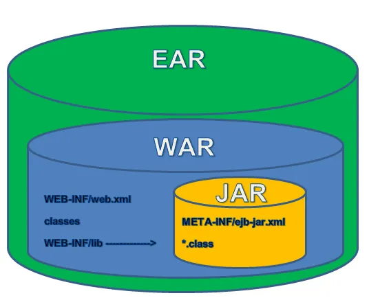
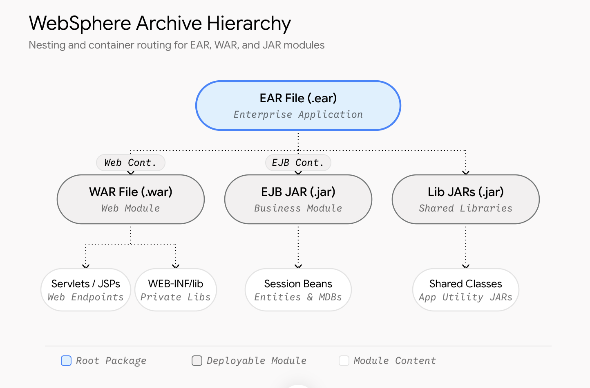

# JAR, WAR and EAR

1. **JAR** = Java Archive
2. **WAR** = Web Archive
3. **EAR** = Enterprise Archive

At their core, JAR, WAR and EAR files are essentially **ZIP** archives with specific internal directory structures and metadata. These represent different tiers of a Java Enterprise application, and they are designed to nest inside one another when deployed to an application server like WebSphere (WAS).

 *Source=Medium*

## 1] JAR - The Building Block

- **What it is**: JAR files are the most basic archive format in Java. JARs packages compiled `*.class` files, metadata and resources (like properties and XML files) into a single file.

- **Structure**: Contains a `META-INF/MANIFEST.MF` file.

- **WAS Context**: You should use JARs for reusable utility libraries, backend business logic in the form of Enterprise Java Beans (EJB JARs) or JPA entity classes.

## 2] WAR - The Web Layer

- **What it is**: An archive specifically structured to **deliver web applications over HTTP**.

- **Structure**: must contain a `WEB-INF/` directory. Inside, there is a `WEB-INF/web.xml` (**deployment descriptor**), a `classes/` folder for compiled servlets or controllers, and a `lib/` folder where utility JARs are placed. It also houses static web resources like HTML, CSS, JavaScript and JSPs.

- **WAS Context**: A WAR is deployed into WebSphere's Web Container. If your backend APIs or microservices only need to handle REST/HTTP requests, a standalone WAR is usually sufficient.

## 3] EAR - The Wrapper

- **What it is**: The highest-level deployment unit in Java EE / Jakarta EE. It encapsulates **multiple WARs** and **JARs** into a single cohesive application.

- **Structure**: Contains a `META-INF/application.xml` deployment descriptor that tells the server which WARs and EJB JARs are inside, and how they map to specific context roots.

- **WAS Context**: Deployed at the Application Server level in WebSphere. **WAS** uses the **EAR structure** to manage **classloading** hierarchies (e.g., determining whether to use `PARENT_LAST` or `PARENT_FIRST` classloading) and to share resources globally across all modules within the EAR.

## Use Cases

### Use a JAR
When you are compiling a **common utility library** (like custom date formatters, logging utilites or integration mappings) that needs to be shared across multiple applications, or when defining business logic EJBs.

### Use a WAR
When you are deploying a **standalone web application** or a **RESTful microservice** (like a Spring Boot application packaged for external deployment). If the application **does not require EJBs** or multiple **distinct modules** communicating internally, deploying a **standalone WAR** is perfectly fine and often preferred for modern, decentralized architectures.

### Use an EAR
When you have a **complex enterprise system** (such as a large banking application) that consists of **multiple frontends** (**multiple WARs**) sharing a **common backend business logic** tier (EJBs JARs). Packaging them in an EAR allows WAS to deploy them as a single unit, ensuring they share the **same classloader context**, **transaction managers**, and **security roles**.

# WebSphere Archive Hierarchy

## EAR  (target = WAS App Classloader)

Top-level enterprise archive encapsulation. It bundles **web modules** (WARs), **Enterprise Java Beans** (EJB JARs), and **shared libraries** with an `application.xml` deployment descriptor for the WAS.

## WAR (target = Web Container)

Encapsulates the **web application components** (Servlets, JSPs, HTML, JS, CSS) and web-specific libraries. WAS routes incoming HTTP/HTTPS requests directly to the Web Container executing this module.

## EJB JAR (target = EJB Container Engine)

Contains transactional business logic components (stateless/stateful Session Beans and Message-Driven Beans). The WAS EJB Container provides *declarative* security, transaction management and remoting(¿?). 

Core transactional enterprise services and JMS asynchronous message consumers. Executes within WAS EJB container runtime with managed lifecycle and connection pooling. Executes within WebSphere's EJB container runtime with managed lifecycle and connection pooling.

## Lib JARs (target = Application Classloader)

Utility libraries residing in the `EAR(root)` or `EAR/lib` directory. Made accessible to all WAR and EJB modules within the enterprise application, avoiding duplicate dependency loading. Common domain objects, DTOs, DAOs, enums, and utility classes used jointly by Web and EJB tiers across the deployment hierarchy.