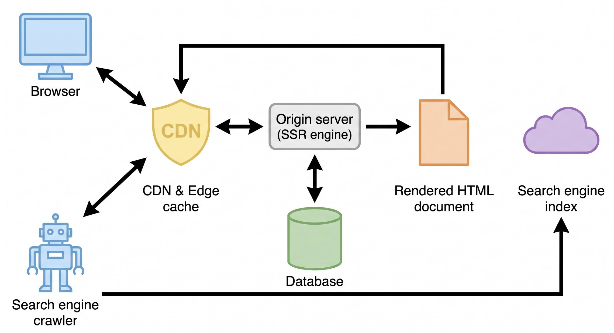

# Server-Side Rendering (SSR) Era

Java enterprise systems originally delivered user interfaces over the web before rich client-side and desktop GUI approaches became standard.

## JavaServer Pages (JSP) and SSR

In server-side rendering (SSR), the web or application server processes an incoming HTTP request, retrieves or computes data, merges that data into a template, and returns a complete HTML document to the browser. JSP is a Java EE (now "Jakarta EE") technology that lets developers author **HTML markup interwoven with dynamic Java expressions**, Expression Language (EL) and **tag libraries** (such as **JSTL**).

Under the hood, a **JSP file** is not interpreted line-by-line like a static text file; the servlet container translates the *.jsp page into a Java servlet class, compiles it, and executes it to stream HTML back to the client.

Over time, architectures moved away from embedding raw Java scriptlets inside JSPs toward **MVC patterns** where **servlets** or **controllers** *prepare model data and forward to JSP views for presentation*.

 *Source=Google AI Images*

# Shift Toward Rich Desktop GUIs in Java

Pure server-rendered HTML pages work well for document-centric navigation and form submissions, but every significant UI state change traditionally required a round trip HTTP request and a full or partial page reload. As enterprise applications demanded responsive charts, drag-and-drop workflows, local hardware access, or continuous client-side state, thin HTML browsers felt limiting.

In the Java ecosystem, rich desktop GUI toolkits (such as **AWT = Abstract Window Toolkit, Swing and later JavaFX**) offered retained scene graphs, hardware-accelerated rendering, CSS-like styling, and rich client state directly on the user's machine. Rather than replacing backend Java/Jakarta EE services, these desktop clients often paired with server-side business logic and data services, separating rich interactive presentation from centralized enterprise processing. 

| Dimension  | SSR JSP   | Rich Desktop GUI (e.g. Java FX) |
| :---       | :---      |          :---                   |
| Primary UI Runtime | Web browser rendering server-generated HTML | Local JVM client running a **scene graph UI**  |
| State & Interactivity | Heavily tied to HTTP requests, sessions and page reloads | Persistent local client state and immediate UI responsiveness |
| Deployment & Updates | Centralized on the server; instant updates for all users | Installed or distributed to client machines; requires client updates |
| Typical Fit | Web portals, content pages, standard form workflows | Data-heavy desktop tools, visual editors, local-first clients  |

# Tracing request-response Lifecycles

## Example 1: Tracing a JSP request in a Servlet Container

A browser requests `/orders.jsp?id=42` for the first time from a Java EE web container. How does the server turn that template into an HTML response?

### 1. Receive the HTTP Request

The web container maps `/orders.jsp` to the **JSP engine** and creates request and response objects for the query GET parameter `id=42`.

### 2. Translate and compile into a servlet

Because this is the first request (or the JSP changed), the container generates servlet source code from `orders.jsp` and compiles it into Java Bytecode.

### 3. Execute server-side logic and render HTML

The compiled servlet runs, evaluates expressions or tag libraries using backend data for order `42`, and writes the finished HTML document to the response stream.

### 4. Return HTML to the browser

The browser receives ready-to-display HTML and renders the page; subsequent requests can reuse the already-compiled servlet class.

## Example 2: Choosing Between JSP rendering and JavaFX Desktop Client

An engineering team is modernizing an internal operations tool that displays live telemetry systems, interactive timelines and multi-panel inspectors alongside enterprise database records. How should they evaluate SSR vs a rich Java GUI?

### 1. Audit interaction and state demands

Identify whether the UI relies on simple form submissions or requires continuous local state, smooth animations, and rapid multi-panel updates without constant full-page reloads.

### 2. Evaluate client deployment constraints

Compare zero-install browser access via server-rendered web pages against managing desktop runtime installations and updates across user workstations.

### 3. Align with backend Java EE services

Keep business rules, security and database persistence on the server tier while choosing JSP/web views for browser reach or JavaFX when rich client interactivity is paramount.