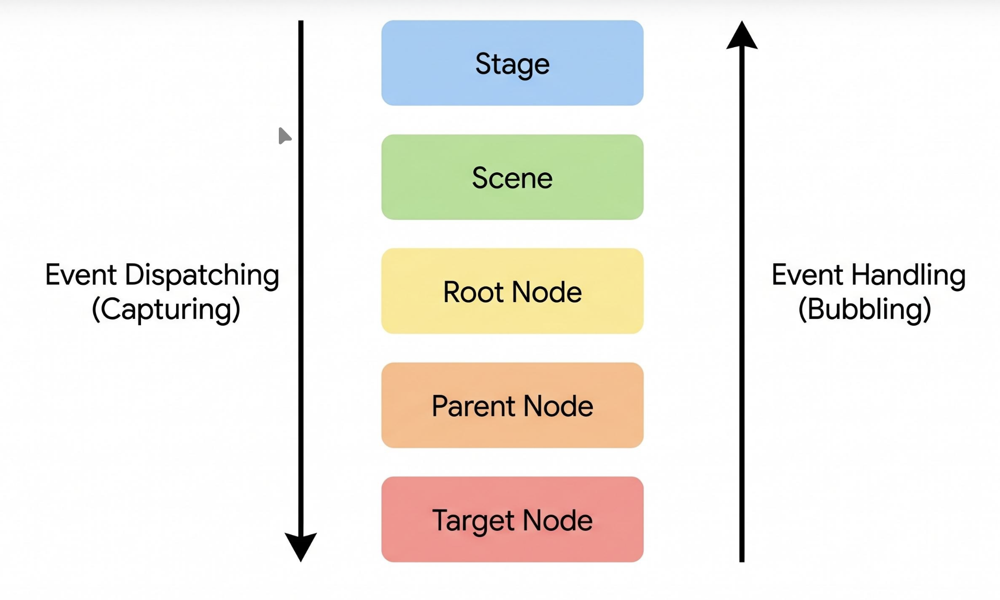

# JavaFX

JavaFX is Java's modern GUI toolkit for building hardware-accelerated desktop applications. When paired with a Java EE backend, it enables **end-to-end Java development**, allowing teams to **share domain models**, **validation rules** and **type-safe contracts** between client and server without maintaining a separate web frontend stack.

# Core Concepts

## Stage, Scene and Scene Graph Hierarchy

JavaFX structures every desktop interface using a strict theatrical metaphor backed by a retained-mode ***graphics engine*** (**Prism**) and a ***native windowing layer*** (**Glass**).

- **JavaFX Application** (`Application`): The entry point of a desktop client. The runtime invokes `start(Stage primaryStage)` on the JavaFX Application Thread to initialize the user interface.

- **Stage** (`javafx.stage.Stage`): The top-level native OS window (complete with title bar, borders and minimize/close controls). Your application receives a `primaryStage` at launch and can open secondary `Stage` instances for dialogs or auxiliary windows.

- **Scene** (`javafx.scene.Scene`): The drawable content surface housed inside a `Stage`. A `Stage` displays only one `Scene` at a time, though you can swap different `Scene` instances onto the same `Stage` to navigate between views.

- **Scene Graph** (`javafx.scene.Node`): A hierarchical tree of visual elements rendered inside a `Scene`. Every element in the tree is called a `Node`, categorized into 3 structural roles:
    1. **Root Node**: The single top-level `Parent` node passed into the `Scene` constructor.
    2. **Branch Nodes**: Container and layout nodes (such as `VBox`, `HBox`, `BorderPane` or `Group`) that hold and position child nodes.
    3. **Leaf Nodes**: Terminal visual elements (such as `Button`, `Label`, `TextField` or `Canvas`) that render content and cannot have children.

 *JavaFX Stage, Scene and Scene Tree Hierarchy. Source: Google AI*

# JavaFX vs Web UI Frameworks

While standard web frameworks like `React` (a JS library, actually) and `Angular` target the DOM, JavaFX renders directly onto a hardware-accelerated graphics pipeline **inside the JVM**.

| **Architectural Dimension** |  **React**   |  **Angular**  | **JavaFX** | 
|      :---    |       :---    |       :---    |     :---    |
| Rendering Target  | Virtual DOM -> Browser DOM  | Incremental DOM / Browser DOM  | Retained-mode Scene Graph via **Prism** (**DirectX/OpenGL/Metal**)  |
| State and Data Binding  | Unidirectional state (`useState`, props) and explicit event callbacks  | Bidirectional binding (`ngModel`), Signals and RxJS observables  | Observable properties (`StringPropery`, `ObservableList`) with bidirectional binding  |
| Layout and Styling  | HTML elements + CSS Flexbox/Grid | HTML templates + encapsulated component CSS  | Built-in layout panes (`GridPane`, `BorderPane`) + JavaFX CSS  |
| Java EE Integration  | Decoupled JSON over HTTP/REST or GraphQL  | Decoupled JSON over HTTP/REST or GraphQL with TypeScript models | Direct sharing of Java DTOs, interfaces and binary or REST protocols  |

## Worked Examples

### 1. Assembling a Stage, Scene and Scene Graph
Build a JavaFX login window containing a username input and submit button. Then, display it on the primary window.

i. **Create Leaf Control Nodes** (leaf nodes must exist before being added to containers). Instantiate the terminal UI controls that users interact with directly:

```java
TextField usernameField = new TextField();
Button loginButton = new Button("Sign In");
```

ii. **Assemble the Root Branch Node**: Place the leaf nodes inside a layout container (`VBox`) that serves as the single root of the Scene Graph:

```java
VBox root = new VBox(10, usernameField, loginButton);
```

iii. **Create the Scene with the Root Node** (A `Scene` requires a non-null Parent root at construction): Wrap the root node inside a `Scene` and define its viewport dimensions:

```java
Scene loginScene = new Scene(root, 400, 250);
```

iv. **Attach the Scene to the Stage and Show**: Bind the `Scene` to the native window `Stage` and make the window visible:

```java
primaryStage.setTitle("Enterprise Portal");
primaryStage.setScene(loginScene);
primaryStage.show();
```

### 2. Swapping Scenes on a Single Stage

After verifying credentials against a Java EE authentication service, transition the user from the login view to a main dashboard without spawning a second OS window (hence the term "swap").

i. **Build the Dashboard Scene Graph**: Construct a separate layout hierarchy for the authenticated view and wrap it in a second `Scene`:

```java
BorderPane dashboardRoot = new BorderPane();
Scene dashboardScene = new Scene(dashboardRoot, 1024, 768);
```

ii. **Swap the Active Scene on the Existing Stage** (Must execute on the JavaFX Application Thread): Call `setScene` on the existing `primaryStage` inside the login button's event handler to swap the entire Scene Graph in place:

```java
loginButton.setOnAction(event -> primaryStage.setScene(dashboardScene));
```